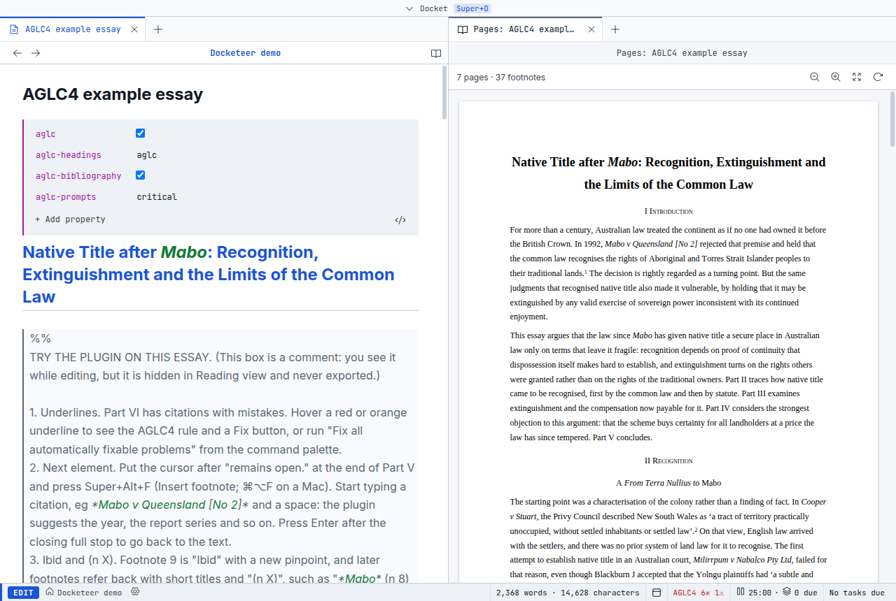

# Docketeer

**[Website and guide](https://blursedperf.github.io/Docketeer/)** ·
**[Download](https://blursedperf.github.io/Docketeer/download)** ·
[Getting started](https://blursedperf.github.io/Docketeer/guide/getting-started) ·
[Privacy](https://blursedperf.github.io/Docketeer/privacy)

> **Beta**: stable enough for daily use, with new features and fixes arriving often. Keep a backup of your notes, as
> with any app, and please [report problems](../../issues).

A Markdown notes app for law students that runs **entirely offline**: notes are plain
`.md` files in a folder of your own (a **homebase**), and the app cannot reach the network. Every request is blocked
by the app itself, whatever a plugin tries. Free for macOS and Linux.



I'm always on my laptop, where sidebars take up too much room, and I wanted a keyboard-first notes app
that lets me barely take my hands off the keyboard while creating and placing notes, editing and searching.
Everything is reached through **the Docket**, a tray that drops from the top of the window (**⌘D** on macOS,
**Super+D** on Linux): search across notes, commands, and panels for authorities, the outline, subjects and topics,
citations, the homebase and the layout. Panels can be hidden, reordered and built from commands, file trees, note
lists and sections. Notes tile into panes from the keyboard.

## What is in it

- **The Docket**: search, commands and panels in one tray, with prefixes (`>` commands, `+` new note, `@`
  authorities, `~` outlines, `?` every shortcut). [Guide](https://blursedperf.github.io/Docketeer/guide/docket)
- **Writing**: live preview, a `/` menu with case brief and IRAC scaffolds, properties, templates, offline spelling
  with legal terms, PDFs with page quotes, lecture recordings with timestamps, export to PDF.
- **Locking**: lock a note or a whole subject and it is encrypted on disk.
  [Guide](https://blursedperf.github.io/Docketeer/guide/locking)
- **Homebases**: a *Legal* or *Generic* starting layout, or a template saved from one of your own.

Four plugins ship built in:

| Plugin | What it does |
|---|---|
| **AGLC4 Citations** (`plugins/aglc4`) | Footnotes to the *Australian Guide to Legal Citation*, checked as you write; Word, HTML and PDF export with a bibliography; version history |
| **Task Docket** (`plugins/task-docket`) | Every task in the homebase in a Tasks panel in the Docket, by when it is due |
| **Whole-Tree Search** (`plugins/whole-tree-search`) | `~` in the Docket finds words in your outlines, each match with the heading above it, its parents and what is nested under it |
| **Pomodoro Flashcards** (`plugins/pomodoro-flashcards`) | Flashcards written in your notes and case briefs, studied with spaced repetition beside a focus timer, with a Study panel in the Docket |

To look around first, choose *Try the example homebase* on the welcome screen (or *Switch homebase* → *Open the
example homebase*): sample law notes with a case brief, a lecture recording and a reading, copied into "Docketeer
example" in your Documents. Its source is in [packages/app/example](packages/app/example).

The [website](https://blursedperf.github.io/Docketeer/) has the full user guide. For the design: [PLAN.md](PLAN.md)
(the architecture, the plugin API and the roadmap) and [docs/docket](docs/docket) (the Docket's design, its panels
and every shortcut).

## Install

[Download](https://blursedperf.github.io/Docketeer/download) from the website, or from the [releases](../../releases):
a `.dmg` for macOS (Apple Silicon or Intel), an AppImage for any Linux, a `.pacman` package for Arch/Omarchy or a
`.deb` for Debian/Ubuntu. The macOS app is not notarised yet: the first time you open it, click **Done** on the
warning, then **Open Anyway** in System Settings → Privacy & Security (or run
`xattr -dr com.apple.quarantine /Applications/Docketeer.app` once). Windows is not built yet; iPhone and iPad are in
testing.

## Run from source

```bash
npm install
npm start            # build and open Docketeer (choose a folder as a homebase)
```

Pass `--homebase=/path/to/folder` after `npm start --` to open a folder directly.

## Develop

```bash
npm run build        # plugins, then the app (packages/app/dist)
npm test             # typecheck, CSS token lint, unit tests (API, app, every plugin), build, offline audit
npm run smoke        # boot the app offscreen on a throwaway homebase and drive it end to end
npm run shots        # screenshots of every surface in several palettes, densities and icon sets
npm run shots:diff -- <dir>   # compare them with test/visual/<platform>/ (--update to accept)
npm run audit        # offline audit only
npm run dist         # installers for this OS in packages/app/release
```

Releases are built by `.github/workflows/release.yml` when a `v*` tag is pushed: tests and the smoke
test first, then packages on Linux x64, Linux arm64 and macOS, then a GitHub release with checksums and
build attestations.

`npm run smoke` prints a JSON report of its end-to-end checks (editing, links, the Docket and its panels, tiling,
locking, every built-in plugin, export, settings, and that requests from both the page and the main process are
refused) and saves a screenshot. Set `QUIRE_SMOKE_OUT` to choose where.

The website is in `site/` (VitePress, with its own `package.json`): `cd site && npm install && npm run dev`. The Site
workflow publishes it to GitHub Pages on every release tag, so its download links and screenshots match the release.

| Path | What |
|---|---|
| `packages/api` | `@quire/api`: the plugin API (vault, metadata, workspace, editor, UI) — the app's renderer runtime |
| `packages/app` | Electron shell: `src/main` (main process, preload), `src/renderer` (core UI, theme, smoke test) |
| `plugins/aglc4` | AGLC4 Citations |
| `plugins/task-docket` | Task Docket: the Tasks panel |
| `plugins/whole-tree-search` | Whole-Tree Search: `~` in the Docket searches outlines |
| `plugins/pomodoro-flashcards` | Pomodoro Flashcards: flashcards, spaced repetition, a focus timer and the Study panel |
| `packages/ios` | the iPhone and iPad app (a Swift shell around the same page), in testing |
| `site` | the website: user guide and downloads |
| `scripts/offline-audit.mjs` | fails the build if anything shipped could reach the network or run generated code |

## Themes

Settings → Appearance has 16 palettes (from DoomEsque), an accent colour, fonts, density and the icon
set (Phosphor by default). Themes and CSS snippets are files in `<homebase>/.quire/`; see
[docs/theming.md](docs/theming.md) and the [Appearance guide](https://blursedperf.github.io/Docketeer/guide/appearance). Design notes: [icon sets](docs/design/icons.md),
[polish plan](docs/design/polish-plan.md).

## Writing a plugin

A plugin is a folder in `<homebase>/.quire/plugins/<id>/` with `manifest.json`, `main.js` and optionally
`styles.css`. `main.js` is an **ES module** whose default export extends `Plugin`:

```ts
import { Notice, Plugin } from '@quire/api';

export default class Hello extends Plugin {
	async onload() {
		this.addCommand({ id: 'hello', name: 'Say hello', callback: () => new Notice('Hello') });
	}
}
```

Bundle with esbuild (`format: 'esm'`), marking `@quire/api`, `@codemirror/*` and `@lezer/*` external:
the app supplies its own instances at run time through an import map. `plugins/aglc4/esbuild.config.mjs`
is a working example. Docketeer calls the folder of notes a *homebase*; in the API it is `app.vault`, with
`app.homebase` as an alias. More on the
website: [Writing plugins](https://blursedperf.github.io/Docketeer/plugins).
