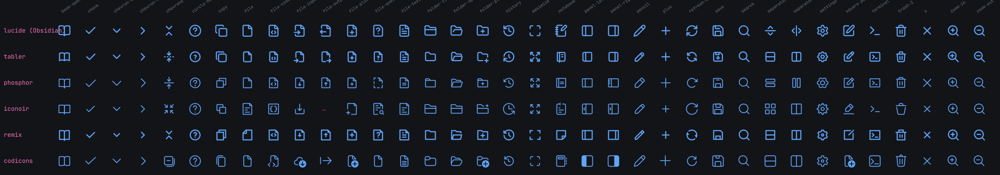

# Icons: choosing a set that is not Obsidian's

Obsidian draws its interface with [Lucide](https://lucide.dev). Docketeer used Lucide too, which made it look
like Obsidian at a glance. This compares the alternatives and records the choice.

## What Docketeer needs

- **34 icons** used by the app and the AGLC4 plugin (file, folder, search, history, book-open, settings,
  zoom, split, terminal, trash …).
- **Lucide names keep working.** Plugins call `setIcon(el, 'history')` with Lucide names, so a set is
  reached through a Lucide-name alias table, and a name the set lacks still draws (from Lucide).
- **Offline and bundled.** No icon fonts or CDNs; the SVG data is built into the app.
- **A licence that allows redistribution inside an MIT app**, including as a user-selectable option.

## Candidates

All are on npm; each was downloaded and checked against the 34 icons ([sheet below](#comparison)).

| Set | Licence | Icons | Covers Docketeer's 34 | Style | Notes |
|---|---|---|---|---|---|
| **Lucide** (current) | ISC | 1,700+ | 34 | 2px round stroke, 24 grid | Obsidian's set. |
| **Tabler** | MIT | 5,491 | 34 | 2px round stroke, 24 grid | Feather lineage like Lucide: changing to it changes almost nothing visible. |
| **Phosphor** | MIT | 1,512 × 6 weights | 34 | Single filled path, 256 grid | Thin, light, regular, bold, fill, duotone. Softer, distinct shapes (book, gear, sidebar). |
| **Remix** | Remix Icon Licence v1.0 (was Apache-2.0) | 3,229 | 34 | Geometric line, square-ish | Closest to the flat DoomEsque chrome, but see licence. |
| **Codicons** (VS Code) | CC-BY-4.0 | 639 | 34 | 16 grid, filled | Attribution required; small set; some poor matches (file-input). |
| **Iconoir** | MIT | 1,383 | 33 | 1.5px stroke | No good "file-output"; inconsistent metaphors. |

### Licence findings

- **Remix Icon changed licence in January 2026** to a custom "Remix Icon License v1.0" (npm still says
  Apache-2.0). It allows use inside apps, but **forbids using the icons to make a competing icon set or
  library (§3.2)** and **forbids using any icon as an app icon or brand mark (§3.3)**. Offering icon sets as
  a theme option that plugins and themes can draw from is close enough to §3.2 to be a risk, so Remix is
  ruled out as the default.
- **Codicons** needs visible attribution (CC-BY-4.0).
- **Phosphor, Tabler, Iconoir**: MIT; **Lucide**: ISC.

## Comparison

Each row draws the same 34 Docketeer icons (Lucide names on top):

## Decision

**Phosphor is the default**, with Lucide kept as an alternative and as the fallback for names Phosphor
does not have.

- Clearly not Obsidian's look, while staying calm and legible next to text.
- MIT, and every icon in every weight is one `<path>`, so it bundles as plain strings (about 2.6 MB for
  four weights, built from `@phosphor-icons/core` at build time; nothing is fetched at run time).
- **Weights are a theme option**: thin, light, regular, bold. Bold reads better at small sizes on
  high-DPI screens; light suits the crisp palettes.

### How it works

- `@quire/api` keeps a registry of icon sets (`registerIconPack`, `setIconPack`). `setIcon(el, name)`
  records the name on the element (`data-icon`), so switching set or weight redraws every icon on screen.
- `packages/app/src/renderer/icon-packs.ts` holds the Lucide → Phosphor alias table (220 names, all checked
  to exist) and registers the set.
- A name that is neither in the alias table nor a Phosphor name falls back to Lucide, so plugins never
  show a blank.
- Choose under **Settings → Appearance → Icons**.

### Follow-ups

- Size: Phosphor's regular weight looks lighter than Lucide at 18px. The polish plan sets icon sizes per
  context (16 / 18 / 20) rather than one size everywhere.
- The app icon (`docs/design/app-icon-source.jpeg`, rendered by `scripts/app-icon.swift`) uses no icon set.
