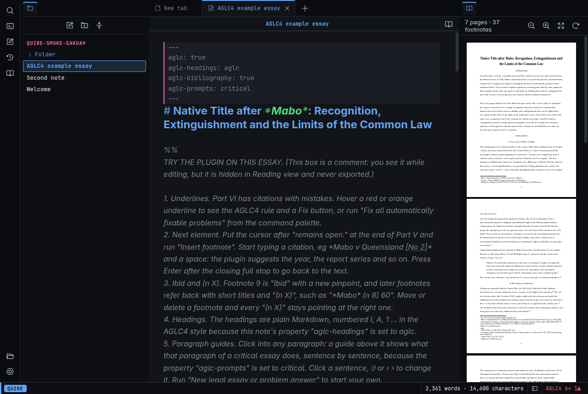

# Polish plan: spacing, alignment and consistency

Based on a screenshot review of Quire 0.1 with theming (`npm run shots` captures every surface below in
16 palettes, three densities and two icon sets). The aim is an interface that lines up on a grid, uses a
small set of sizes, and looks deliberate in every palette.

## 1. Audit

Severity: **H** visibly broken or misaligned; **M** inconsistent; **L** refinement.

### Window frame and panes

| # | Finding | Sev |
|---|---|---|
| F1 | The three columns' header bands do not line up: left sidebar tab strip, root tab strip and right sidebar tab strip have the same height, but the row under them (explorer action bar ≈ 40px, view header 32px, page-preview toolbar ≈ 44px) differs, so there is no continuous horizontal line across the window. | H |
| F2 | A stray empty **New tab** sits beside a note opened with "open in new tab" when the only tab was empty. An empty, unpinned tab should be reused. | H |
| F3 | Sidebar tab strips show a lone icon at the far left with no title; with one tab, the strip is wasted space. | M |
| F4 | Resize handles are 1px with an invisible 7px hit area; there is no hover affordance on the sidebar edges until hovered exactly. | L |
| F5 | Ribbon icons sit at uneven vertical intervals (gap 4px plus 6px padding), and the bottom group is not separated from the top group. | L |

### File explorer

| # | Finding | Sev |
|---|---|---|
| E1 | File names do not align with folder names: folders start text after a 14px chevron, files are indented by a fixed 26px. Text should share one column at each depth. | H |
| E2 | Indent guides are drawn at a fixed offset rather than under the parent chevron. | M |
| E3 | The homebase title is the same size as items and crowds the action bar. | L |
| E4 | Rows have 1px gaps that show as stripes on hover in light palettes. | L |

### Editor and reading view

| # | Finding | Sev |
|---|---|---|
| D1 | The frontmatter block's fence lines (`---`) take full line height and the heading after it has no top margin, so the title collides with the drawer. | M |
| D2 | Heading sizes (1.48 / 1.30 / 1.16 em) and line height 1.65 are set separately in source and reading views; they drift. Define once. | M |
| D3 | `%% comment %%` text is italic and faint, which hides the AGLC4 tour; comments need a block treatment (left rule, muted, not italic). | M |
| D4 | The readable line width (46rem) is the same at every text size; it should be measured in characters (~75ch). | L |

### Popups: palette, switcher, menus, notices

| # | Finding | Sev |
|---|---|---|
| P1 | Command names repeat "AGLC4 Citations:" on every row. Show the plugin name as a muted prefix (or group), the command name in normal weight. | M |
| P2 | Rows in the palette, switcher and menus have three different heights (≈ 30, 28, 26px) and paddings. | M |
| P3 | Quick switcher puts the folder on a second line for some rows only, so rows jump in height. Put the folder right-aligned on the same line. | M |
| P4 | The menu has no submenu or shortcut column; icons and labels are fine but the separator margins are uneven. | L |
| P5 | Notices stack at the top right over the page preview's toolbar. | L |

### Settings

| # | Finding | Sev |
|---|---|---|
| S1 | Controls have no common width: dropdowns size to their content (≈ 95–130px), text inputs are 220px, sliders 150px. Right edges align but left edges jump. | H |
| S2 | The dialog has no title bar and the close button floats over the content. | M |
| S3 | Section headings sit 24px above but only ~8px above their first row in some sections (after a description-only heading). | M |
| S4 | Button rows without a name (e.g. "Reload themes and snippets") are right-aligned with an empty left side. | L |
| S5 | Long descriptions (AGLC4 settings) run to the full width; cap at ~70ch. | L |
| S6 | No search box; with plugin settings the list is long. | L |

### Status bar (modeline)

| # | Finding | Sev |
|---|---|---|
| M1 | Items are separated by hairlines but have uneven paddings; the AGLC4 count and the word count use different text weights. | L |
| M2 | The "QUIRE" badge does not reflect the mode or the active pane (Doom's modeline shows the major mode). | L |

### Cross-cutting

| # | Finding | Sev |
|---|---|---|
| X1 | **Eleven font sizes** in use (10, 10.5, 11, 11.5, 12, 12.5, 13, 13px-ui, 15, 20 px and em sizes). | H |
| X2 | **Spacing values** are ad hoc (2, 3, 4, 5, 6, 7, 8, 10, 12, 14, 16, 20, 24, 36 px). | H |
| X3 | Icons are 18px everywhere except a few 14–15px overrides; Phosphor regular reads light at 18px. | M |
| X4 | Keyboard focus is visible on inputs only; buttons, tree rows, tabs and menu items have no focus ring. | M |
| X5 | Monospace and sans are mixed by component rather than by role. | M |
| X6 | Some light palettes (Solarized, Gruvbox Light) give low contrast to faint text on the sidebar surface; check derived tokens on `bg-alt`, not just `bg`. | M |

## 2. Design tokens

Everything below becomes CSS custom properties in one block, and components use only these. Density
(already implemented: compact / comfortable / spacious) scales the spacing and row tokens.

**Spacing (4px grid):** `--space-1: 4px`, `--space-2: 8px`, `--space-3: 12px`, `--space-4: 16px`,
`--space-6: 24px`, `--space-8: 32px`. Nothing else.

**Type scale (UI):** `--text-xs: 11px` (status bar, badges), `--text-sm: 12px` (tabs, tree, menus),
`--text-md: 13px` (settings, palette), `--text-lg: 15px` (dialog titles). Note text keeps em sizes from
`--font-text-size`. Headings: one scale shared by source and reading views.

**Font roles:** UI chrome (tabs, tree, modeline, keys, paths) = monospace; prose (settings descriptions,
notices, dialogs, notes) = interface/text font. Documented so themes can swap a role in one place.

**Heights:** `--header-band: 36px` for every top row (tab strips and the row beneath them use
`--subheader-band: 32px` in all three columns); `--row: 26px` (tree, menus, palette, switcher: one row
height); `--control: 28px` (buttons, inputs, selects); `--status: 26px`.

**Icons:** `--icon-sm: 14px` (inline, tree chevrons), `--icon-md: 16px` (menus, tabs, tree),
`--icon-lg: 18px` (ribbon, toolbars). Phosphor weight follows size: bold at 14px, regular above.

**Controls:** settings controls in a fixed-width column (`--control-width: 200px`; toggles right-aligned
in it; sliders and dropdowns fill it).

**Focus:** one ring for everything focusable: `outline: 2px solid var(--doom-blue); outline-offset: -2px`
on `:focus-visible`.

## 3. Work, in order

1. **Tokens.** Add the token block; replace fixed sizes in `app.css` with tokens (X1, X2, X3, X5).
   Lint: a test that fails on raw px values outside the token block (allow-list for 1px borders).
2. **Header bands.** One height for the row under the tab strips in all columns; explorer action bar,
   view header and plugin toolbars sit in it (F1). Sidebar strip shows the view title when it has one
   tab (F3).
3. **Explorer.** Grid per row: `[indent][chevron slot 16px][icon slot?][name]`; files get an empty chevron
   slot so names align (E1); guides under the chevron (E2).
4. **Rows.** One row component for tree, menu, palette, switcher (P2, P3, E4); plugin prefix muted (P1).
5. **Settings.** Control column (S1), dialog title bar (S2), heading rhythm (S3), named button rows
   (S4), description width (S5); later a settings search (S6).
6. **Editor.** Frontmatter drawer spacing (D1), shared heading scale (D2), comment blocks (D3), ch-based
   line width (D4).
7. **Workspace behaviour.** Reuse an empty tab (F2); notices bottom-right above the modeline (P5).
8. **Focus and contrast.** Focus ring (X4); contrast check of derived tokens on `bg-alt` for every
   palette, run in CI (X6).
9. **Modeline.** Even padding, one weight (M1); badge shows the active view's mode (M2).

## 4. Verifying

- `npm run shots` after each step; keep the PNGs as a baseline and diff them (pixel diff with a
  threshold) so unintended changes show up in review.
- Smoke test keeps passing in every density (add a loop over densities and two palettes).
- Alignment checks in the smoke test: measure `getBoundingClientRect()` of the header rows in all three
  columns (equal `bottom`), and the text start of a file and a folder at the same depth (equal `left`).
- Manual pass in the smallest window size (640 × 400) and at 200% zoom.
