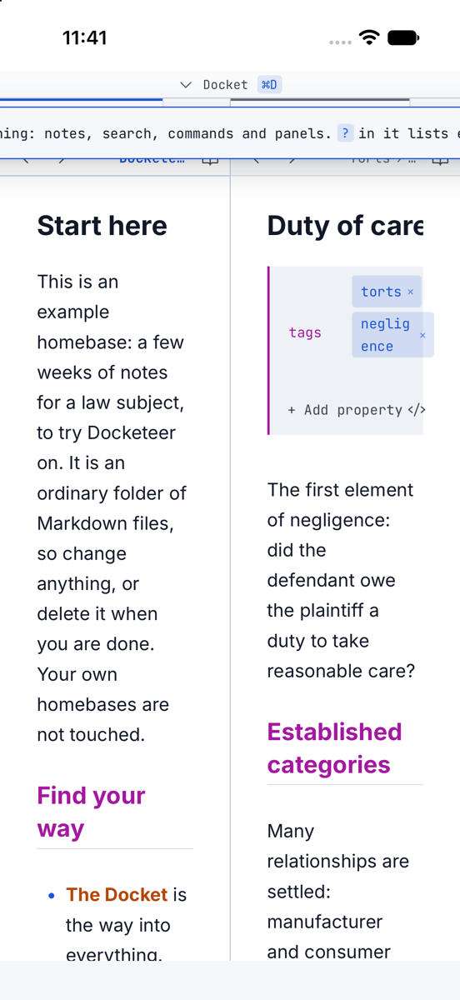
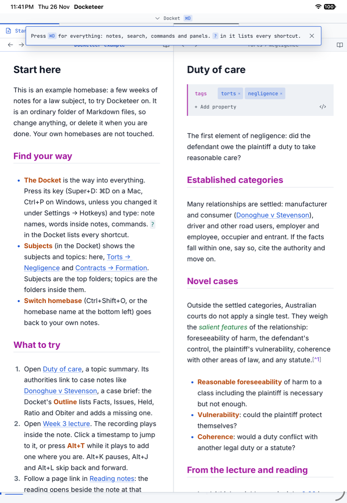

# Phase 0 spike: does editing feel right on iPhone and iPad?

The question from [PLAN.md](PLAN.md), Phase 0: does CodeMirror 6 live preview feel right on an iPhone keyboard and
an iPad with a Magic Keyboard? This is the Phase 0 shell: the desktop layout, the example homebase held in memory
(edits are not saved), no compact layout yet.

## Simulators (2026-11-26)

iOS 27.2 simulators, iPhone 17 and iPad Pro 11-inch (M5), Debug build: the app boots into the example homebase
on both, with no console errors and no refused navigations.

| iPhone 17 | iPad Pro 11-inch |
|---|---|
|  |  |

## iPhone (2026-11-27)

Tried by the owner on an iPhone 15 Pro Max, from Xcode.

- **Editing feels great.** No problems reported with typing or live preview.
- **Opening is very fast**: the example homebase is there at once.
- **The Docket is too wide for the iPhone.** Expected: the phone gets the Docket as a sheet in Phase 3.
- **Tabs take too much room.** The owner suggests putting open tabs behind a "show open tabs" button on the
  phone. Added to Phase 3 (compact layout).

Not reported on separately: selection handles and the edit menu, autocorrect, dictation, undo (shake or
three-finger swipe), `[[` suggestions by touch. None came up as a problem.

## iPad (2026-11-27)

Tried by the owner with a Logitech keyboard for iPad.

- **Works as intended**: editing, and the shortcuts tried (⌘D for the Docket, ⌘2 for its panels, ⌘\ to
  split) reach the page; iPadOS does not take them.
- **The keyboard has no Escape key.** For now: Settings → General → Keyboard → Hardware Keyboard → Modifier
  Keys, Caps Lock → Escape. Docketeer should not need Escape alone: Phase 2 adds ⌘. as Escape (a `UIKeyCommand`
  forwarded to the page). The Docket key already closes the Docket.

## Verdict

Editing feels right on both. The owner confirmed the Phase 0 exit check on 2026-11-27. What is left is layout
(the phone, Phase 3) and Escape on keyboards without one (Phase 2).
