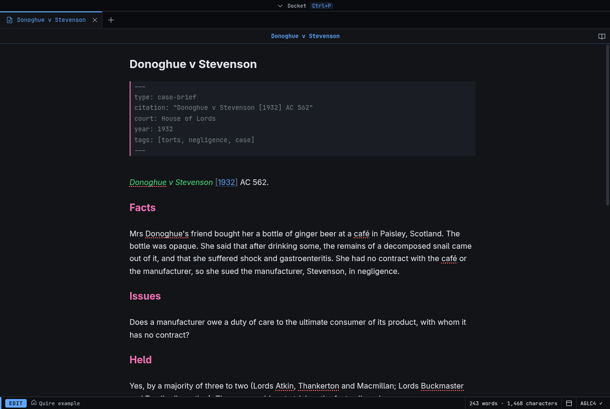
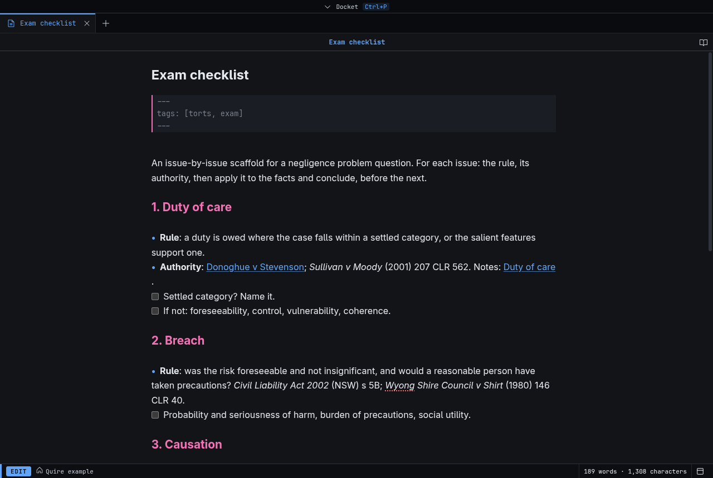
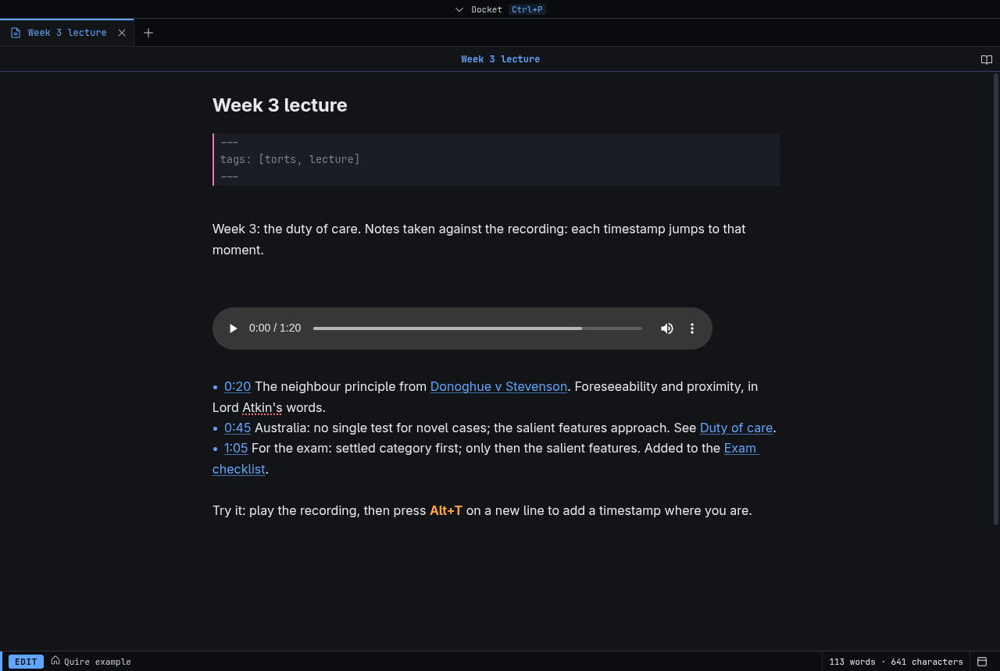
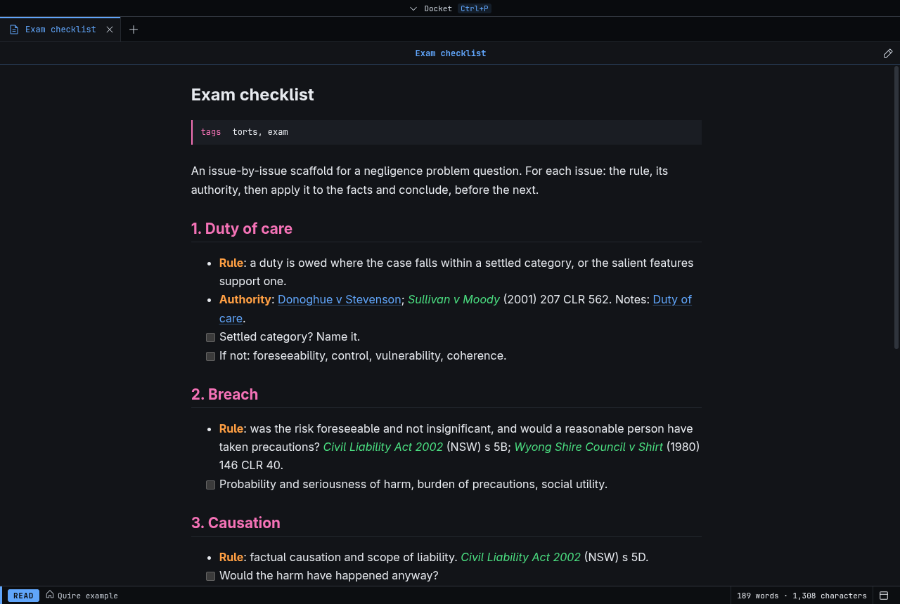
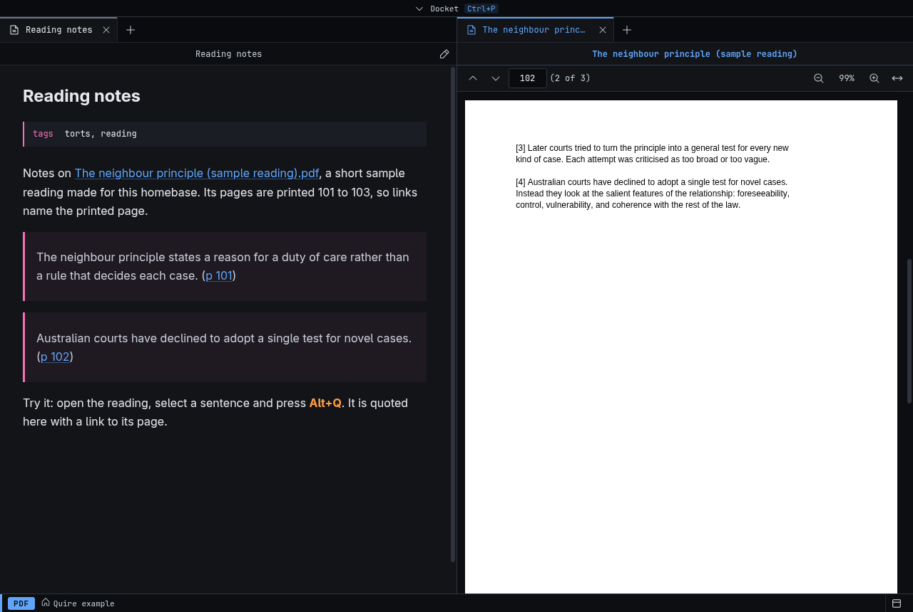

# Note-taking polish: what to fix and improve next

Review of Caselore 0.9.0, 2026-11-25. The [polish plan](../design/polish-plan.md) (grid, tokens, alignment) is
done; this looks at what is left once real notes are in it. Method: the 44 reference screenshots, plus captures of
the example homebase (case brief, lecture note with a recording, reading beside a PDF, exam checklist) in edit and
reading views, and a read of the code behind each finding.

Findings are in three groups: **bugs** (wrong, and cheap to fix), **visual polish**, and **workflow** (fewer
keystrokes or less hunting while taking notes). Each says what was seen, where it comes from, and what to do.

## 1. Bugs

| # | Seen | Cause | Fix |
|---|---|---|---|
| B1 | Every bracketed citation part is drawn as a link: `[1932]` in *Donoghue v Stevenson* [1932] AC 562, pinpoints `[78]`, `[2002] HCA 14`. In law notes this is on almost every line.  | Lezer's Markdown parser reads `[1932]` as a shortcut reference link and tags it `t.link`; `cm-setup.ts` styles `t.link` as `.cm-link`. | Style a `Link` node as a link only when it has a URL or its label matches a reference definition in the note. Test with AGLC4 citations. |
| B2 | A full stop after a link can wrap onto a line of its own ("Notes: Duty of care" / ".").  | Probably `Decoration.replace({})` for the hidden `]]` in `live-preview.ts`: CodeMirror's widget buffers around replaced ranges leave a line-break opportunity. Not yet confirmed. | Reproduce in a smoke check (the punctuation's top equals the link's top); if confirmed, hide the marks with a zero-width mark decoration instead of a replacement. |
| B3 | "café" is marked as misspelt. | The en-AU dictionary (SCOWL) has only "cafe"; Caselore checks the word as written. | Accept a word whose accent-free form is correct (café, naïve, rôle, résumé). |
| B4 | Names are marked on every line: *Donoghue's*, *Atkin's*, *Thankerton*, *Buckmaster*, *Wyong*, even inside an italicised case name. | Proper names are not in any dictionary; case names in running text are not treated as citations. | Accept words that occur in the homebase's note names and in the authorities the AGLC4 plugin finds in the note; optionally skip Capitalised words mid-sentence (a setting). |
| B5 | A large empty band above an embedded recording.  | The `![[…]]` line's text is hidden but the line stays, then the block widget adds its own padding. | When the embed line is not being edited, replace the whole line with the player (a block replacement), not text-hiding plus a widget. |

## 2. Visual polish

**V1. Properties in edit mode.** Edit mode shows raw YAML (`---`, `tags: [torts, lecture]`, `---`) taking 70–160 px at
the top of every note; reading view already draws a tidy key/value table. Draw the same table in live preview, and
show the YAML only while the cursor is in it. Every note in a student's homebase has tags, so this is on every
screen. *Medium.*

**V2. The title is shown three times.** Tab, header band and the name-as-title above the text all say "Week 3
lecture" (and often the first heading does too). Keep the tab and the title above the text; use the header band for
**where the note is**: *Torts › Negligence*, each part opening that subject or topic in Units. That turns a
redundant line into context that is otherwise only in the Docket. *Small.*

**V3. Edit and reading views style text differently.** Bold is white in edit mode and orange in reading view;
italics white and green; headings have a rule under them only when reading; task boxes sit at different indents.
Switching with Ctrl+E makes the note jump and change colour. One set of inline styles for both (the polish plan's
D2 shared the heading scale only).  *Small.*

**V4. A player that belongs to the theme.** The embedded player is Chromium's own (a light grey pill on the dark
theme). Replace it with a compact bar in the theme's colours: play, time, speed, and a scrubber with **a tick for
every timestamp in the note**, so the notes are visible on the timeline and clicking a tick jumps there. *Medium.*

**V5. Links to sources look like links to notes.** `0:20`, `p 101` and `The neighbour principle (sample
reading).pdf` are all plain blue underlines. Draw source links as small chips: ▶ 0:20 for a timestamp, a page icon
and *p 101* for a PDF page, and a PDF's name without `.pdf`. Readers can then tell at a glance what a link opens and
where. *Small.*

**V6. PDF chrome.** The PDF tab uses two rows (header band, then its toolbar), about 70 px. Put the page box and
zoom in the header band. Add **dark pages** (an inverted, slightly dimmed page) for long reading in dark palettes:
the white page is the brightest thing on screen.  *Small.*

**V7. Footnote references.** `[^1]` shows as written in live preview. While the cursor is elsewhere, show it as a
superscript number with the footnote's text on hover. The AGLC4 plugin relies on the syntax, so the change must
leave the text and the plugin's underlines alone. *Medium (needs checking with the plugin).*

**V8. Docket details.** While search results are shown, the last panel's tab (e.g. *Outline*) stays highlighted, as
if it were what the results belong to; highlight no tab while searching. The keys row at the bottom could be hidden
once the user has used the Docket for a while (a setting). *Small.*

## 3. Workflow

**W1. New notes from a scaffold** (research step 4, still the biggest gain). Ctrl+N asks only for a name and folder.
A choice of scaffold (case brief, statute, principle, lecture, exam issue) with fields and headings ready, in the
same dialog, removes the most repeated typing in a law student's week. The example homebase's notes are the
starting templates.

**W2. A lecture note in one step.** *New lecture note*: dated name ("Week 4 lecture"), the subject's folder, and a
recording picked from the homebase (or the newest in it) embedded at the top, cursor on the first bullet.

**W3. Timestamps that match what was said.** People press Alt+T after hearing the point. Options: insert the time
**a few seconds earlier** (default 3 s); at the start of an empty line, start a list item; **pause while typing**
and resume (rewinding 2 s) when typing stops. All three are settings with sensible defaults.

**W4. Say where a quote went.** Alt+Q puts the quote in the note while the keyboard stays in the PDF, so nothing
shows that it worked. Flash the inserted lines in the note and show "Quoted into *Reading notes*". If two notes are
open, quote into the one beside the PDF.

**W5. Keys for everyday formatting.** Bold, italics and links have keys; highlight, strikethrough, code and tasks
do not. Add Mod+Shift+H (highlight), Mod+Enter (toggle a task box: the most frequent action in a checklist), and
Alt+1 … Alt+6 for heading levels (Mod+1 … 9 are the Docket's panels).

**W6. A word target in the status bar.** Essays have limits. With `words: 3000` in a note's properties (the Outline
to Draft plugin already uses it), the status bar shows *1,374 / 3,000* and turns amber near the limit and red past
it. Footnotes counted or not, as the assignment says (a setting).

**W7. Focus while writing.** A focus mode: hide the chrome, keep the cursor's line near the middle of the screen,
and dim the other paragraphs. For essays and exam answers.

**W8. Fewer false spelling marks** (B4) is a workflow issue as much as a bug: red underlines under every party's
name teach people to ignore the spellchecker.

## Progress

| Item | Status |
|---|---|
| B1 citation brackets | **Done.** Only links with a URL or a defined reference get `.cm-link` (`realLinkRanges`, unit-tested). |
| B2 punctuation after links | **Done.** Cause confirmed: widget buffers (inline images) around the replaced `]]`. Hidden syntax followed by text is now a `display: none` mark. |
| B3 accented words | **Done.** A word whose accent-free form is in the dictionary is accepted (tested with the real en-AU dictionary). |
| B5 gap above embeds | **Done.** An embed-only line collapses while not edited; an embed of a missing file stays visible. |
| B4 / W8 names | **Done.** Words in note and file names, and in the authorities found in the note (parties, short titles, authors), are accepted with their possessives; *Skip names* (on by default) leaves capitalised words mid-sentence alone. Finding authorities costs ~5 ms per edit on a 59,000-character note (cached per document version). |

| V1 properties table | **Done.** `properties-editor.ts`: a block widget over the frontmatter (a state field, as block replacements must be); shown as YAML while the selection is in it; invalid YAML always as written. A cursor at position 0 (where notes open) does not count as editing. |
| V2 header trail | **Done.** `MarkdownView.updateTitle`: subject › topic, each part firing `reveal-folder`, which the Docket shows in Units. |
| V3 one set of styles | **Done.** The cause of plain bold and italics in lists was `.cm-list { color: inherit }` overriding them (every token in a list also carries `cm-list`); removed. H1/H2 lines get the reading view's rule. |

Smoke check: *live preview: citation brackets are not links, punctuation stays with its link, embeds take their
line*.

## 4. Suggested order

| # | Work | Why | Size |
|---|---|---|---|
| 1 | B1, B3, B5, then B2 once confirmed | Visible on every law note; small | S |
| 2 | B4 and W8: names from notes and authorities | The most frequent annoyance after B1 | S–M |
| 3 | V1 properties table, V2 breadcrumb, V3 one set of styles | Every note, every screen | M |
| 4 | W5 formatting keys, W6 word target | Cheap, used constantly | S |
| 5 | V5 source chips, W3 timestamp options, W4 quote feedback | Finish the recording and PDF workflows | M |
| 6 | W1 scaffolds and W2 lecture notes | The largest saving; builds on 1–5 | M–L |
| 7 | V4 themed player with ticks, V6 PDF chrome and dark pages | Polish for long sessions | M |
| 8 | V7 footnotes, V8 Docket details, W7 focus mode | Refinements | S–M |

Each should come with a smoke or unit check (B1: an AGLC4 line has no `.cm-link`; B2: punctuation stays on the
link's line; B3: "café" accepted; V1: no YAML text visible away from the cursor) and, where the screen changes,
updated screenshot references.
