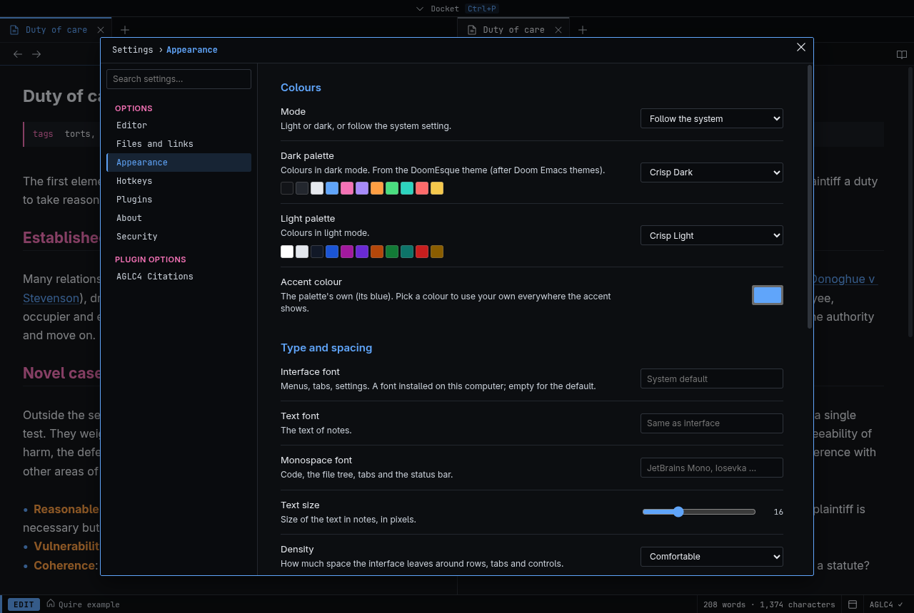
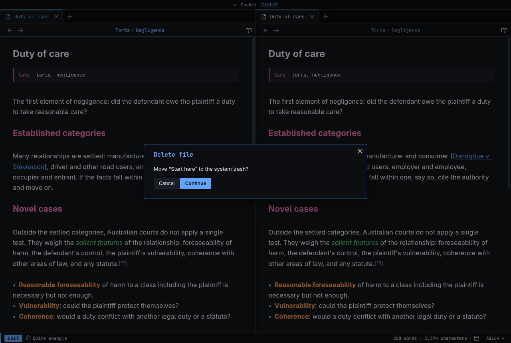
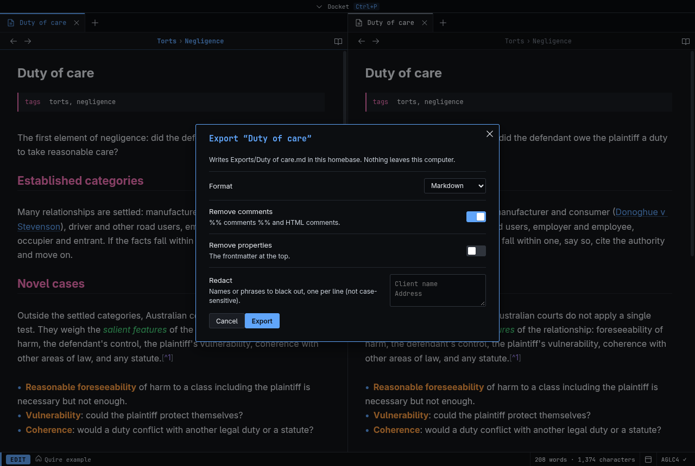
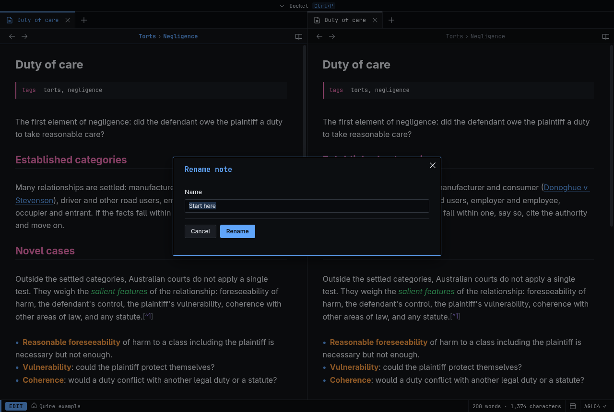
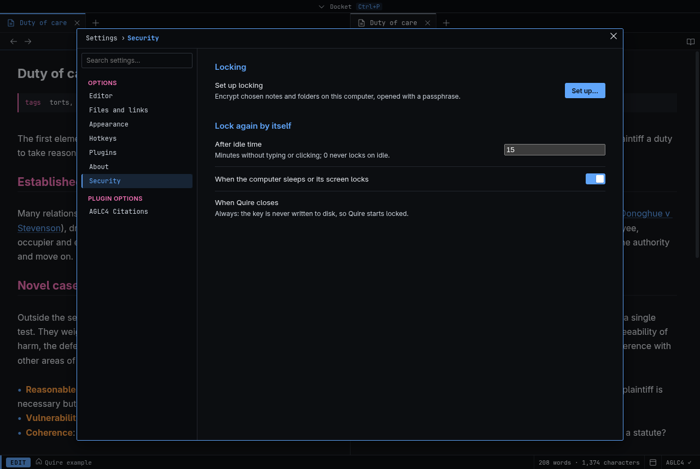
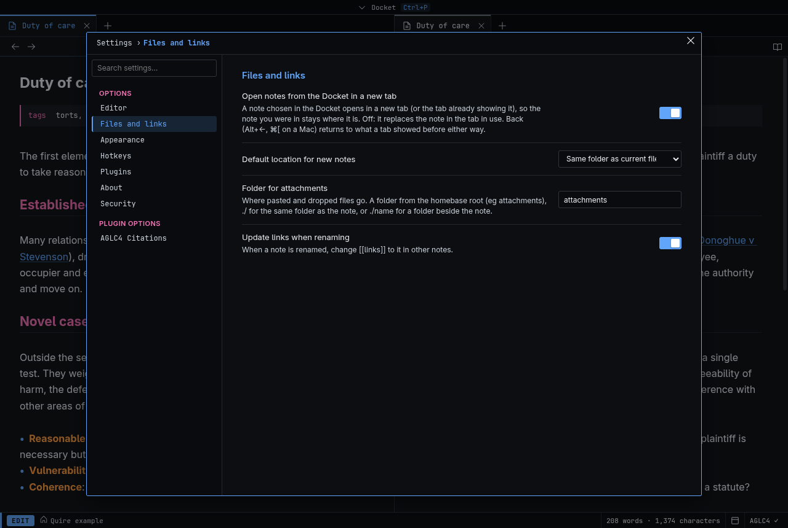
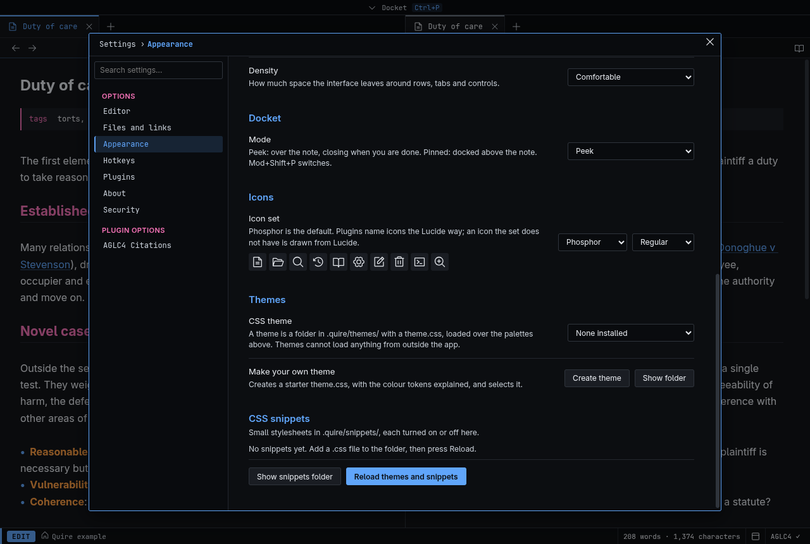
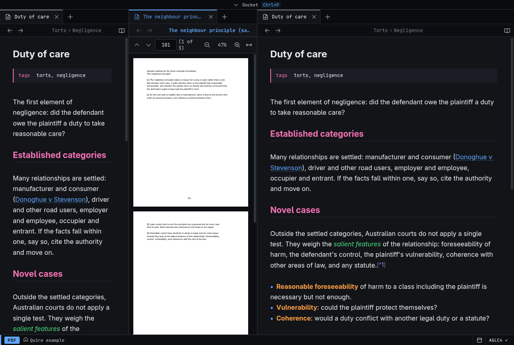
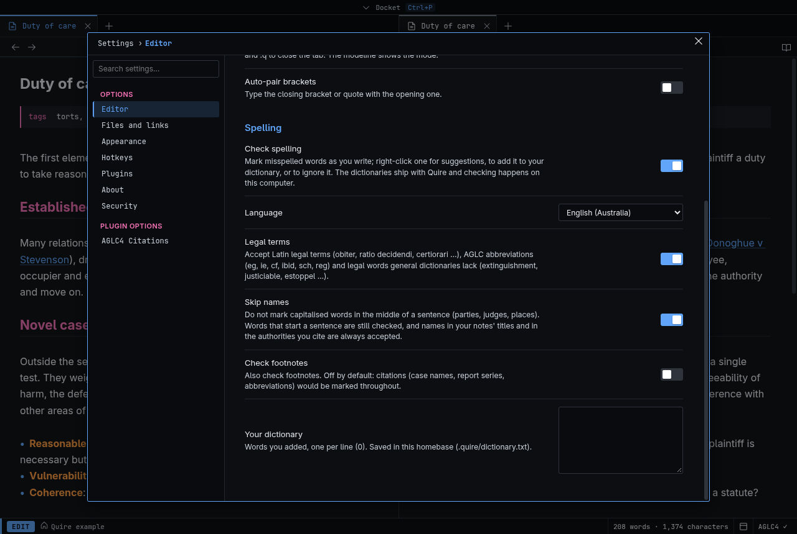

# Buttons, spacing and settings: review of 0.15.1

Every settings page, the dialogs (new note, rename, delete, export) and the PDF toolbar, captured in the example
homebase, with the stylesheet and the code behind each finding. Ordered by how often they are met.

## Findings

| # | Seen | Cause | Fix |
|---|---|---|---|
| 1 | **Fonts are typed, not chosen.** Interface, text and monospace font are free text boxes: you must know a font's exact name, nothing says whether it exists, and there is no preview.  | No list of installed fonts: the renderer cannot read them (Docketeer refuses every permission, and the Local Font Access API needs one), and nothing in the main process looks. | The main process lists the fonts installed on the computer by reading the font folders (Linux `~/.local/share/fonts`, `/usr/share/fonts`, `/usr/local/share/fonts`; macOS `/System/Library/Fonts`, `/Library/Fonts`, `~/Library/Fonts`; Windows `%WINDIR%\Fonts` and the user's fonts folder) and the family names inside the files (the TTF/OTF `name` table): offline, no programs run (the audit forbids child processes). Settings get a **dropdown** per font: *System default* (or *Same as interface*), the installed families, monospace ones first for the monospace font, and *Other…* to type a name; under it a line of sample text in the chosen font. |
| 2 | **Dialog buttons are laid out two ways, and one way is broken.** Delete and Export use `.modal-button-container`, which has **no styles**: the buttons touch, sit at the left, and Export's are jammed under the Redact box. New note, Rename and the locking dialogs use a row of Setting buttons: spaced, but also on the left, under a divider.    | Two patterns grew up; the CSS only covers one. | One pattern, styled once: buttons **right-aligned**, 8 px apart, the main action last, space above the row. `.modal-button-container` styled, and the Setting-button rows in dialogs drawn the same way. |
| 3 | **Destructive confirmations look like any other.** Deleting a note asks "Move … to the system trash?" with a blue **Continue**. | The shared confirm uses the accent button and a generic label for everything. | A `danger` option: red (`mod-warning`, already in the CSS) and a label that says what happens: **Move to trash**, **Delete panel**, **Remove lock**. |
| 4 | **A box drawn by the browser.** Security → *After idle time* is a grey, square, full-height native number box, unlike every other field.  | The input styles cover `type="text"`, `search` and untyped inputs, not `number`. | Style `input[type=number]` like the others (and hide the spin buttons); a narrow box with "minutes" after it. |
| 5 | **The right edge moves between settings pages.** Controls end 10 px further right on short pages (Files, Plugins, About, Security) than on long ones (Editor, Appearance).  | The page's scrollbar takes room only when the page scrolls. | `scrollbar-gutter: stable` on the settings page, as the PDF view has. |
| 6 | **Dropdown text cut off.** *Default location for new notes* reads "Same folder as current fil…". | The control column is a fixed 200 px; the longest option is wider. | Shorter options ("Folder of the open note", "Top of the homebase", "A folder I choose"), and selects may grow to 260 px before clipping. |
| 7 | **The accent colour is used for ordinary buttons.** *Reload themes and snippets* and *Set up…* are blue on settings pages where every other button is plain, so they look like the page's main action. *Show snippets folder* and *Reload* sit left in a row of their own, while *Create theme* / *Show folder* sit right in a named row.  | `setCta()` used for emphasis; button-only rows are left-aligned (`.mod-buttons`). | Accent only for the main action of a dialog. On settings pages, buttons belong to a named row (*CSS snippets: Show folder, Reload*), right-aligned like the other controls. |
| 8 | **The PDF toolbar wraps** in a narrow pane: "(1 of 3)" breaks onto two lines and pushes the zoom buttons.  | No `nowrap`, and nothing gives way when narrow. | `white-space: nowrap`; under ~360 px the count and the zoom percentage are hidden (the page box stays). |
| 9 | **Labels float beside tall text boxes.** *Your dictionary*, AGLC4's *Folders* and *Disabled rules*: the name and description are centred on a 100 px box, so they read as belonging to the space between rows.  | Rows centre their contents vertically. | Rows holding a text area align to the top. |

Smaller points: the accent colour swatch is taller than other controls (28 vs 26 px); *Make your own theme* puts two
buttons where one (*Create theme*, then the folder opens) would do.

## Suggested order

1, 2 and 3 together (the font list, and one dialog button row with a danger style); then 4–9, which are each a few
lines of CSS or a label. Each should come with an updated screenshot reference and, for 1, a unit test of reading
family names from a font file and a smoke check that the dropdown lists the fonts found and saves a choice.
